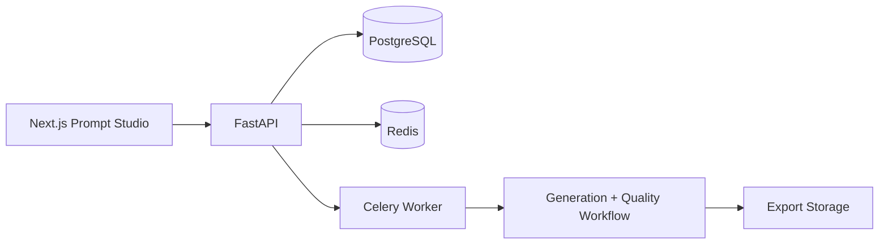

# DataForge AI

DataForge AI turns natural-language dataset requests into typed, versioned synthetic datasets. This repository is a working MVP designed to grow into a production SaaS platform.

## What works today

- Secure registration, login, access tokens, and tenant-scoped dataset access.
- Prompt analysis into a typed Pydantic schema.
- Deterministic local generation with no API key, or a Celery-ready generation pipeline.
- Immutable dataset versions, paginated record preview, quality scoring, and record edits that create a new version.
- CSV, JSON, JSONL, and XLSX downloads.
- PostgreSQL/Redis/Docker development stack, Alembic migration, Prometheus metrics, tests, and CI.

The local generator is intentional: it makes the system safe to run and test before incurring model costs. Production LLM support belongs behind the `app/ai` provider boundary; generated responses must still pass the same Pydantic and quality validation.

## Architecture



## Run locally without Docker

Prerequisites: Python 3.11+ and Node.js 22+.

```powershell
cd backend
python -m venv .venv
.\.venv\Scripts\Activate.ps1
pip install -e ".[dev]"
uvicorn app.main:app --reload
```

The default development database is `backend/dataforge.db` and generation is inline. In another terminal:

```powershell
cd frontend
npm install
$env:NEXT_PUBLIC_API_BASE_URL="http://localhost:8000/api/v1"
npm run dev
```

Open `http://localhost:3000`. API documentation is at `http://localhost:8000/docs`; metrics are at `http://localhost:8000/metrics`.

## Run the full infrastructure stack

```powershell
Copy-Item .env.example .env
docker compose up --build
```

For Docker, set `JOB_EXECUTION=celery` in `.env`. Run migrations after the database is healthy:

```powershell
docker compose exec api alembic upgrade head
```

## Free Render demo deployment

The repository includes a zero-cost deployment configuration at `render.yaml`. It deploys the local provider (no LLM API key), an inline FastAPI API, a static frontend, and a free temporary Postgres database. Follow [the Render deployment guide](docs/DEPLOY_RENDER.md) before deploying.

## Quality semantics

Quality reports verify required fields, exact-schema records, duplicates, and label distributions. They measure internal consistency only. They do **not** establish that synthetic data represents real people or real-world populations.

## Key API flow

1. `POST /api/v1/auth/register`
2. `POST /api/v1/prompts/analyze`
3. `POST /api/v1/datasets`
4. `POST /api/v1/datasets/{dataset_id}/generate`
5. `GET /api/v1/datasets/{dataset_id}/versions`
6. `GET /api/v1/dataset-versions/{version_id}/export?format=csv`

Use an `Authorization: Bearer <access-token>` header for every endpoint after authentication.

## Development checks

```powershell
cd backend
pytest
ruff check app tests

cd ..\frontend
npm run build
```

## Next production increments

- Implement OpenAI/Hugging Face provider adapters with structured-output schemas and token/cost accounting.
- Move large record payloads from JSON columns to partitioned storage/Parquet plus a query index.
- Add refresh-token persistence/revocation, password reset, rate limiting, audit records, and S3 signed URLs.
- Add model-driven repair batches, semantic duplicate detection, and browser end-to-end tests.
